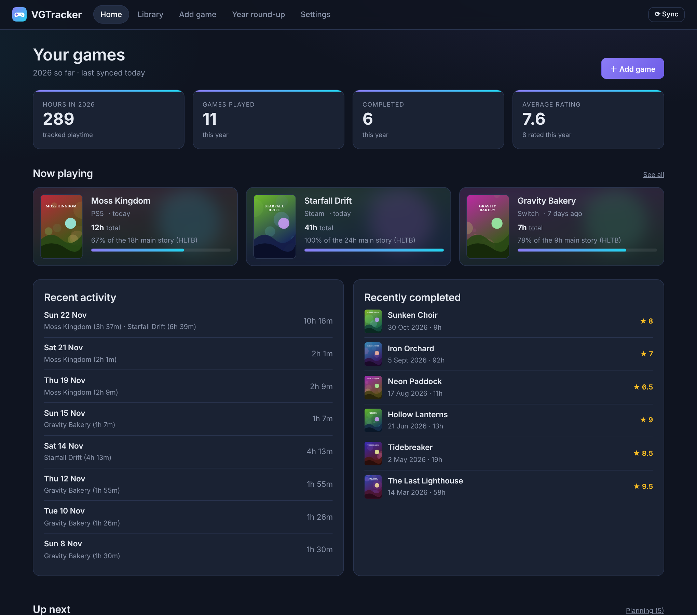
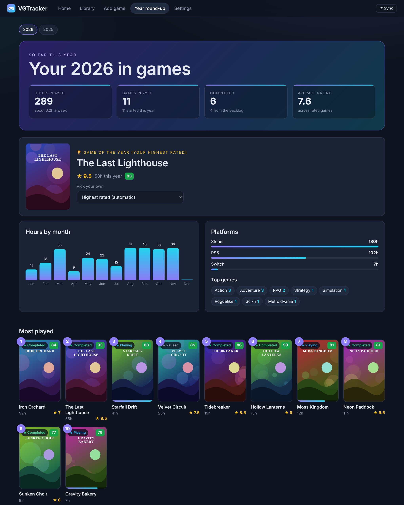
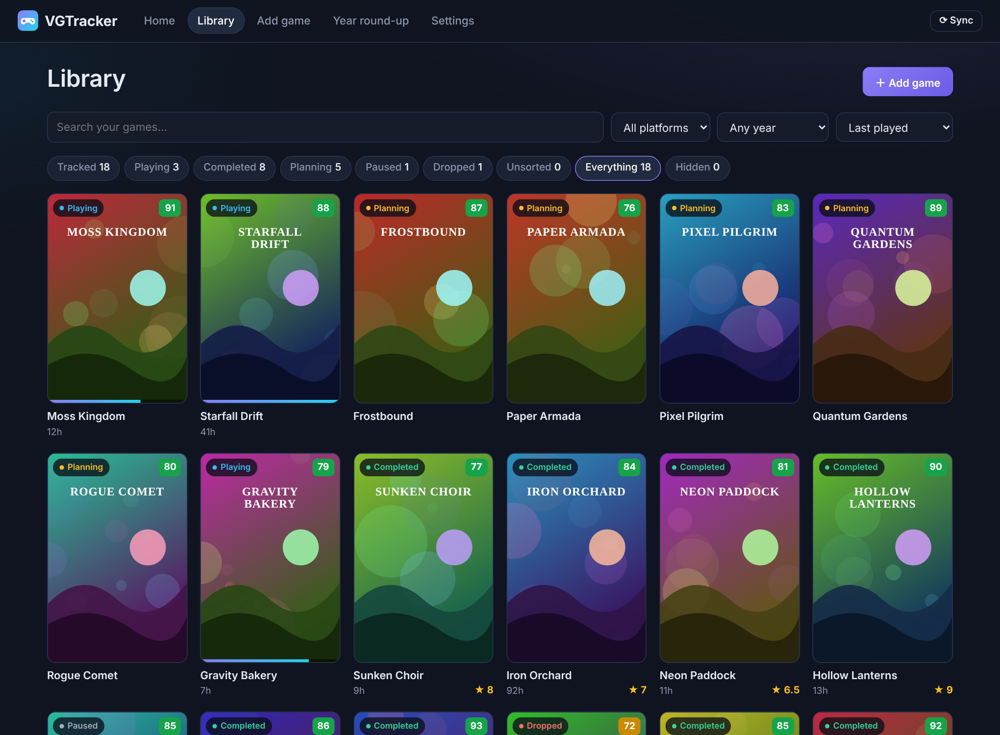
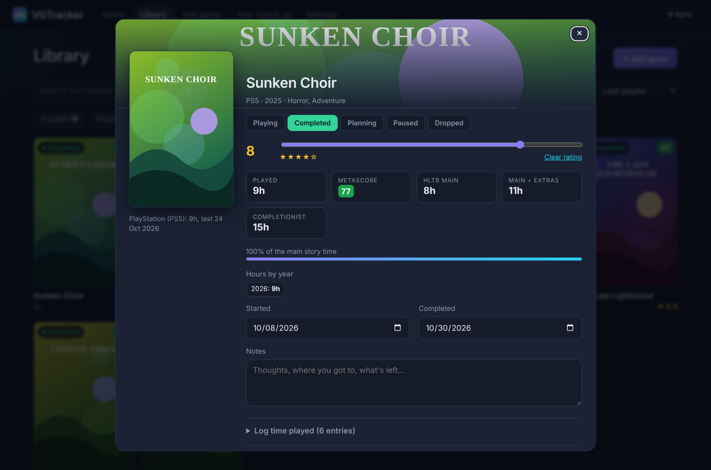
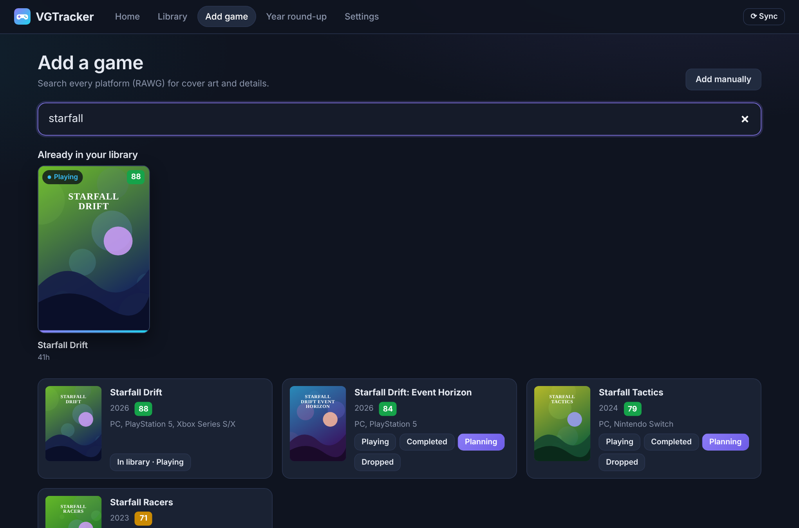

# 🎮 VGTracker

A lightweight, self-hosted video game tracker. It syncs what you play on **Steam**, **PlayStation** and **Xbox** automatically, picks up PC games from other launchers through **ActivityWatch**, records your playtime year by year, and gives you a round-up at the end of every year.

It runs as a single Docker container. Your data stays on your server, in a single SQLite file.



## Features

- **Automatic sync**: connects to Steam (Web API), PlayStation Network (PS4 and PS5) and Xbox (consoles and the Xbox app on PC, via OpenXBL), and syncs every few hours. Steam Deck playtime is included in Steam. Games you start playing move to **Playing** automatically.
- **Battle.net, EA, Epic, Ubisoft and emulators**: if you run [ActivityWatch](https://activitywatch.net), pick which apps are games and their time is added automatically, day by day.
- **Hours by year**: Steam, PlayStation and Xbox only report lifetime totals, so VGTracker records the difference at every sync. Your playtime is then known per day, per month and per year, not just in total.
- **Statuses**: Playing, Completed, Planning, Paused and Dropped. Completion dates are set when you mark a game as completed. Tools, demos and soundtracks from your Steam library can be hidden.
- **Ratings** out of 10 in half steps, plus notes and start and finish dates.
- **Search and add**: search for any game with cover art. Uses [RAWG](https://rawg.io/apidocs) (free key) for every platform, or the Steam store if you don't add a key.
- **Metascores and HowLongToBeat**: Metascores, genres and release dates come from RAWG and Steam. Main story, main + extras and completionist times come from HowLongToBeat. Both are fetched in the background, and there's a progress bar against the main story time for games you're playing.
- **Manual time logging** for platforms that can't sync (Switch, Xbox, retro).
- **Merge duplicates**, for example when you own the same game on Steam and PlayStation (most are matched automatically).
- **Year round-up**: hours played, games played and completed, your game of the year, hours by month, platform split, top genres, most played, top rated, your biggest gaming day and where you disagreed with the critics. Past years are always available, and the current year's round-up is highlighted on the home page every December.
- **Yamtrack import**: bring games, statuses, scores, playtime, dates and notes across from a Yamtrack CSV export.
- **Setup wizard** on first run, walking you through connecting accounts, game details, importing and a password.
- **Optional password**: set, change or remove it in Settings. Each device stays signed in for 90 days.
- **Homepage / Glance widget**: a JSON endpoint with what you're playing, hours this year and games completed.
- **Backup and restore** as a single JSON file.

Built with Python (Flask), SQLite and plain JavaScript. There's no build step.

| Year round-up | Library |
|---|---|
|  |  |
| **Game details** | **Search and add** |
|  |  |

*Screenshots use made-up demo games and cover art.*

## Quick start (Docker Compose)

Images are published for `linux/amd64` and `linux/arm64`.

```yaml
services:
  vgtracker:
    image: ghcr.io/ashstancill/vgtracker:latest
    container_name: vgtracker
    restart: unless-stopped
    user: "1000:1000"
    ports:
      - "8715:8000"
    environment:
      - TZ=Europe/London
    volumes:
      - ./data:/data
```

```bash
mkdir -p data          # create it first, so the container user (1000) owns it
docker compose up -d
```

Then open `http://<your-server>:8715`. The setup wizard runs the first time you visit.

## Connecting accounts

### Steam

1. Get a Web API key at [steamcommunity.com/dev/apikey](https://steamcommunity.com/dev/apikey). Any domain name works.
2. In Steam, set **Profile → Edit Profile → Privacy Settings → Game details** to **Public**.
3. Enter the key and your profile URL, custom URL name or SteamID64.

### PlayStation

PlayStation has no public API, so VGTracker uses the same endpoints as the PlayStation app, authenticated with your `npsso` token:

1. Sign in at [playstation.com](https://www.playstation.com).
2. In the same browser, open [ca.account.sony.com/api/v1/ssocookie](https://ca.account.sony.com/api/v1/ssocookie).
3. Copy the `npsso` value and paste it into VGTracker.

The sign-in lasts about two months, then you paste a fresh token. Only PS4 and PS5 games report playtime. Treat the token like a password. The API is unofficial and could change or break.

### Xbox

Xbox has no public API for players, so VGTracker uses [OpenXBL](https://xbl.io), a free third-party service:

1. Sign in at [xbl.io](https://xbl.io) with your Microsoft account.
2. Create an API key on your OpenXBL profile page and paste it into VGTracker.

This covers Xbox consoles and PC games played through the Xbox app. OpenXBL's free plan limits requests per hour, so VGTracker fetches playtime for up to 40 games per sync. With a long Xbox history, older games fill in over the first few syncs.

### Battle.net and other PC games (ActivityWatch)

Battle.net, the EA app, Epic and Ubisoft Connect have no playtime API. If you run [ActivityWatch](https://activitywatch.net) on your PC, VGTracker can read which app was in the foreground and for how long:

1. Make ActivityWatch reachable from your server. By default it only listens on the PC itself, so set `host = "0.0.0.0"` in its server config and restart it (or run `aw-server` on your server).
2. Enter its address in **Settings → Battle.net and other PC games**, for example `http://192.168.1.20:5600`.
3. Click **Find games in my recent apps** and give each game's app (for example `Overwatch.exe`) a name.

Time is counted per day from 1 January, so mapping an app fills in the whole year straight away. Don't map games you play through Steam, or their time is counted twice. Time with the game window in front counts as play, including when it's paused.

### RAWG (optional)

A free key from [rawg.io/apidocs](https://rawg.io/apidocs) lets you search games on every platform and fills in Metascores and genres. Without it, search uses the Steam store.

### HowLongToBeat

HowLongToBeat has no official API. Times are fetched with the [howlongtobeatpy](https://github.com/ScrappyCocco/HowLongToBeat-PythonAPI) package, which follows changes to their site. If lookups stop working, pull the latest image. You can also enter times by hand.

## How playtime is counted by year

Every sync compares each game's total playtime with the previous sync and logs the difference on the day it was played. From the moment you start using VGTracker, hours are split by year accurately.

For time played **before** your first sync, only lifetime totals are known:

- PlayStation games first played this year are counted towards this year, because their dates are known.
- For other games last played this year, the setup wizard asks whether to count their existing playtime towards this year. This gives a full round-up straight away, but over-counts games you started in an earlier year.

Games last played in a year always appear in that year's round-up. The option only decides whether their hours do.

## Homepage widget

Settings shows a private widget URL. For [Homepage](https://gethomepage.dev):

```yaml
- VGTracker:
    href: http://<your-server>:8715
    widget:
      type: customapi
      url: http://<your-server>:8715/api/widget?token=<token from Settings>
      mappings:
        - field: now_playing
          label: Playing
        - field: hours_this_year
          label: Hours
        - field: completed_this_year
          label: Completed
```

Other fields: `playing`, `played_this_year`, `backlog`, `last_sync`.

## Configuration

| Variable | Description |
|---|---|
| `APP_PASSWORD` | Optional. Sets the password in the Docker config and overrides Settings. Most people should leave this out. |
| `DATA_DIR` | Where data is stored inside the container. The default is `/data`. |
| `TZ` | Time zone, for example `Europe/London`. Playtime is logged against local dates. |

## Data and backups

Everything lives in the mounted `/data` folder:

- `vgtracker.db`: the SQLite database, including your API keys and tokens
- `secret.key`: signs login sessions and the widget link

To back up, copy that folder. **Settings → Download backup** gives you a JSON file of your games and playtime (without keys or tokens).

Keep the data folder on local storage rather than a network share, because SQLite doesn't cope well with network file systems.

## Privacy

Everything is stored only in your `/data` folder. There's no account, no analytics and no tracking. VGTracker connects to Steam, PlayStation Network, OpenXBL, your ActivityWatch server, RAWG and HowLongToBeat only to fetch your games and game details. Cover images are loaded from Steam, RAWG and PlayStation servers.

## Running without Docker

```bash
pip install -r requirements.txt
python app.py      # http://localhost:8000
```

Run it with a single worker process (as the Docker image does), because the sync scheduler runs inside the app.

## License

MIT
